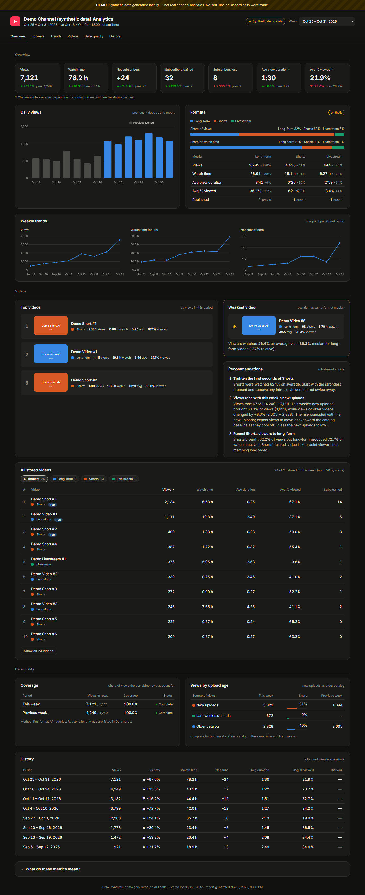
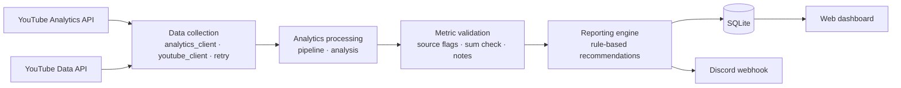
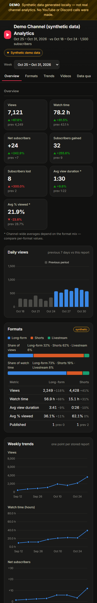

# yt-report — Weekly YouTube Analytics Automation

A Python automation that turns raw YouTube Analytics API data into a weekly analytics
**dashboard**: week-over-week KPIs, a **Shorts / long-form / livestream** breakdown, trends across
all stored weeks, a sortable explorer of every stored video, top and weakest videos, data-backed
recommendations and a transparent data-quality panel. The same report can also be delivered to
**Discord**, and every week is kept in a local **SQLite** history.
A portfolio project by **Davixeqq**, built for and validated against the author's own YouTube
channel. Figures in this repository are synthetic, relative or describe API behaviour — no channel
analytics, credentials or private data are published.


<sub>Real screenshot of the dashboard in demo mode — synthetic data, clearly labelled DEMO in the UI.</sub>

```bash
python -m yt_report demo     # open the dashboard with synthetic data — no credentials, nothing sent
python -m yt_report run      # weekly report from your own channel (Windows or Raspberry Pi cron)
```

**What the dashboard shows**

| Section | Content |
|---|---|
| Overview | Seven KPIs (views, watch time, net / gained / lost subscribers, average view duration, average % viewed) with change and previous value |
| Daily views, Formats | This week vs the previous 7 days per day; share of views and watch time per format; per-format table incl. publications |
| Weekly trends | Views, watch time and net subscribers across every stored week |
| Videos | Top 3, weakest video (retention vs same-format median), recommendations, and all stored videos — filter by format, sort by any metric |
| Data quality | Coverage of per-video rows, views by upload age (new uploads vs older catalog), data notes |
| History | Every stored week; non-consecutive (overlapping) weeks are marked |

Loading, empty and error states, a week selector, section navigation and a responsive mobile
layout are built in; missing values are shown as `n/a`, never as zero.

## Quick start (no credentials needed)

```bash
git clone https://github.com/<you>/youtube-report-bot.git && cd youtube-report-bot
python -m venv .venv                      # Windows: py -3 -m venv .venv
source .venv/bin/activate                 # Windows: .\.venv\Scripts\Activate.ps1
pip install -e ".[dev]"
pytest -q                                 # full test suite, no network access
python -m yt_report demo                  # synthetic data -> separate demo DB + local dashboard
python -m yt_report demo --no-dashboard --print   # same, console summary only
```

Demo mode makes **no YouTube or Discord calls**, needs no `.env`, `credentials.json` or `token.json`,
and writes only to `data/demo/` (git-ignored). The Discord payload it would send is saved to
`data/demo/discord_preview.json` instead.

**Using it with your own channel (local only):**

1. *OAuth*: create a Google Cloud project, enable *YouTube Data API v3* and *YouTube Analytics API*,
   create an OAuth client of type **Desktop app**, save it as `credentials.json` in the project root,
   then run `python -m yt_report auth` (creates `token.json`). Details: [docs/SETUP.md](docs/SETUP.md).
2. *Discord*: Server Settings → Integrations → Webhooks → New Webhook; `cp .env.example .env` and set
   `DISCORD_WEBHOOK_URL` in `.env`.
3. `python -m yt_report check`, then `python -m yt_report run --dry-run --print` (nothing stored or sent).

`credentials.json`, `token.json`, `.env`, `data/` and `logs/` are git-ignored — see [SECURITY.md](SECURITY.md).

---

## 1. Project overview

`yt-report` runs once a week, collects the last 7 completed days of channel analytics, compares
them with the previous 7 days, stores the snapshot and shows it in a local dashboard that keeps
the full history; optionally it also posts a formatted report to Discord. Every figure is labelled with where it
came from (`api`, `derived` or `unavailable`).

## 2. Problem being solved

YouTube Studio shows the numbers, but answering *"how did this week go and what should I change?"*
means repeating the same manual steps every week: choosing comparable date ranges, switching
between Shorts and long-form views, noting the best and worst videos, and remembering last
week's values. The process is repetitive, easy to do inconsistently, and leaves no history in
one place. Channel-wide averages are also easy to misread, because they change whenever the mix
of Shorts and long videos changes.

## 3. Solution

A scheduled pipeline that:

1. pulls data from the official YouTube Data and Analytics APIs (OAuth 2.0, read-only scopes),
2. calculates comparable week-over-week figures per format,
3. validates them (format totals must add up, empty periods stop the run, missing ≠ zero),
4. turns them into 2–3 deterministic recommendations that cite the exact numbers,
5. stores a snapshot in SQLite and posts it to Discord — once per period.

## 4. Main features

| Area | What it does |
|---|---|
| **Weekly comparison** | Views, watch time, subscribers gained / lost / net, average view duration, average % viewed — current vs previous 7 days, with % change. Missing data and division by zero show `n/a`, never 0 %. |
| **Formats** | Shorts, long-form and livestreams from YouTube's own `creatorContentType` (never guessed from duration). Livestreams are never counted as long-form. |
| **Videos** | Top 3 by views (title, thumbnail, link, watch time, retention). Weakest video = lowest retention relative to the median of its **own format**, among videos with enough views. Per-video rows are fetched per format and their coverage of all views is measured and reported. |
| **Publications** | Public uploads per format in both periods (Pacific dates, livestreams by actual start). Private / unlisted / scheduled uploads are excluded and counted separately; uploads without an Analytics format stay *unclassified*. |
| **Recommendations** | Deterministic rules (free, testable). A views change is explained by a decision tree (new-upload spike, publishing change, performance across new and older videos, or "cannot be separated") using "coincided with", never a claimed cause. Retention is judged per format against the same format last week. Optional Claude API mode, off by default. |
| **Discord delivery** | Optional second channel for the same report: 7 embeds with trend arrows, clickable links, *Published* and *Data completeness* fields, Discord limit handling (data notes are shortened by whole notes only, with "+N more notes on the dashboard"), warnings for realigned / overlapping periods and missing previous data, rate-limit retries, secret-free failure alerts, no duplicate posts. |
| **Run safety** | One run at a time: an OS-level lock (stdlib, Windows + Linux) makes a concurrent run exit with code 8 before any API call, database write or Discord post; the OS releases it after success, failure or a crash. |
| **Dashboard** | Local, responsive dark dashboard (stdlib HTTP server + vanilla JS + Chart.js): KPIs, daily views, weekly trends, format split, sortable video explorer with format filter, top/weakest videos, recommendations, coverage and views-by-upload-age panels, data notes, history, section navigation, loading/empty/error states, plain-language glossary. |
| **History** | SQLite snapshots per period (idempotent upsert), per-format and per-video metrics, daily series. |
| **Demo mode** | The real pipeline on synthetic data: no API calls, no Discord, separate database, clearly labelled. |
| **Deployment** | Windows (manual / Task Scheduler), Raspberry Pi (cron, lock file, backups); GitHub Actions CI for the test suite. |

## 5. Architecture



Module-level diagram, data flow and every design decision: [docs/ARCHITECTURE.md](docs/ARCHITECTURE.md).

```
src/yt_report/
  __main__.py            CLI: run · auth · dashboard · demo · test-discord · check
  config.py              .env loading + validation
  auth.py                OAuth 2.0, token refresh, HTTP timeouts
  retry.py               backoff for 429 / 5xx / rate-limit 403
  analytics_client.py    Analytics API queries + derived fallback
  youtube_client.py      channel info, titles, thumbnails
  periods.py             reporting windows (Pacific time, data lag)
  pipeline.py            orchestration and fallback decisions
  analysis.py            comparisons, top/weakest, retention by format, data-quality notes
  recommendations.py     deterministic rule engine
  ai_recommendations.py  optional Claude API (disabled by default)
  formatting.py          display formatting, single rounding rule
  storage.py             SQLite
  discord_notifier.py    Discord embeds and delivery
  dashboard.py, web/     local dashboard
  demo.py                synthetic services for demo mode
tests/                   337 pytest tests, no network
deploy/pi/               install script, cron wrapper, backups, systemd unit
.github/                 CI workflow (tests only, no secrets); dependabot.yml
docs/                    architecture, setup, troubleshooting, case study, demo guide
```

## 6. Technologies used

Python 3.11+ · google-api-python-client · google-auth / google-auth-oauthlib · requests ·
python-dotenv · tzdata · SQLite (stdlib) · `http.server` (stdlib) · HTML / CSS / vanilla
JavaScript + Chart.js · pytest · GitHub Actions · Dependabot · cron / systemd ·
optional `anthropic` SDK.

## 7. API integrations

| Integration | Use | Auth |
|---|---|---|
| YouTube Analytics API v2 | totals, per-format totals, per-video rows, per-video format, daily series | OAuth 2.0, `yt-analytics.readonly` |
| YouTube Data API v3 | channel name / subscribers, uploads playlist, video titles, thumbnails, privacy and live details | OAuth 2.0, `youtube.readonly` |
| Discord webhook | weekly report and failure alerts | webhook URL (secret) |
| Anthropic Claude API (optional) | wording of recommendations from verified metrics | API key, disabled by default |

Behaviour verified against the live API (2026-11-07): `creatorContentType` values are camelCase
(`shorts`, `videoOnDemand`, `liveStream`); `video,creatorContentType` is rejected without a video
filter and works with one; the top-videos report has no pagination (200 rows max), and its
`creatorContentType` filter works although it is undocumented — v1.2.0 uses it as the primary
per-video path, verified against the format totals, with the v1.1 query as automatic fallback.
One run uses about 11–13 Analytics requests and 2 Data API requests per 50 uploads (for example,
about 66 quota units for 1,500 uploads).

## 8. Analytics methodology

- **Periods**: calendar weeks Sunday–Saturday in Pacific time (YouTube's reporting timezone):
  the most recent Saturday on or before today − `DATA_LAG_DAYS` (default 3), compared with the
  week before (`REPORT_WEEK_END`, default `saturday`). Every run in the same week — scheduled,
  retry or manual — reports the same period; `--end-date` is always used as given.
- **API values are authoritative.** Nothing is recalculated when the API returns a figure.
- **Average view duration** is an average per playback, weighted by `engagedViews` — not
  `watch time / views` (on the validation week that ratio was less than half of the API's AVD).
- **Average % viewed** at channel level is total watched time ÷ total length played, so long
  livestreams pull it down. Both channel-wide averages carry the note *"Channel-wide averages
  depend on the format mix — compare per-format values."*
- **Retention changes** are evaluated per format against the same format in the previous week,
  only with API data and ≥ 100 views in both weeks, with absolute + relative thresholds.
- **Weakest video**: retention ÷ median retention of its own format; ≥ 3 videos with ≥ 30 views needed.
- **Coverage**: per-video rows ÷ all views (format totals over every content type); anything below
  100 % is reported and never rounded up to 100 %.
- **Publications**: public uploads only, Pacific dates, `actualStartTime` for livestreams, format
  only from YouTube Analytics. Upload scan capped at 40 pages; reaching the cap marks the counts
  incomplete.
- **Views by upload age**: new-upload views vs the older catalog (the same videos in both
  periods) — the basis of the views-trend decision tree (thresholds in `docs/ARCHITECTURE.md`).
- **Rounding**: one rule (half away from zero) in Python and JavaScript; display only.

Regression tests use synthetic reference weeks in which the format views add up exactly to the
channel total. No real channel figures are stored in this repository.

## 9. Fallback mechanism

| Situation | Result |
|---|---|
| Format totals returned by the API | Shown as-is, labelled `api` |
| Format totals query fails, per-video formats known | Summed from per-video rows, AVD weighted by engaged views, avg % viewed `n/a`, labelled `derived`, warning that watch time may be slightly understated |
| Per-video formats unknown as well | Format section `unavailable`; top videos still shown |
| A format-filtered query falls short of its format total | Rows kept; shortfall reported as "not assigned to any video by the API" (or as a confirmed 200-row cap) |
| Some format-filtered queries fail | Successful formats kept; failed formats filled from the single query |
| All format-filtered queries fail | Single query + format lookup; ≥ 190 rows with missing views flagged as *suspected* truncation |
| Uploads playlist unavailable or scan incomplete | Publication counts `unavailable` / marked incomplete; views-trend recommendation stays neutral |
| Previous and current periods measured differently | Format trends hidden |
| Current period has no data | Run stops (exit 6); nothing stored or sent |

Validated on live data by forcing the fallback: derived AVD matched the API within one second per
format, views were identical, watch time was a few percent low (per-row minute rounding, disclosed).

## 10. Security approach

- Secrets only in `.env`, `credentials.json`, `token.json` or GitHub Secrets — all git-ignored,
  together with databases, logs, backups and demo data. `.env.example` contains placeholders only.
- Read-only OAuth scopes; atomic token writes; the token file is created owner-only (`0600`) on
  Linux/macOS; `--dry-run` never writes the token.
- Webhook allow-list: only `https://discord.com/api/webhooks/…` (and Discord's official hosts) is accepted.
- Every log line passes a redaction filter (webhook URLs, Google tokens, client secrets, API keys).
- Discord failure alerts contain the error type and a short redacted message only.
- Dashboard binds to `127.0.0.1`, escapes all text from the API, allows only `https:` links and
  inline demo images, blocks path traversal, sends `nosniff` / `no-referrer` / `X-Frame-Options: DENY`
  headers, and on a loopback bind answers only requests addressed to `localhost` / `127.0.0.1`
  (HTTP 403 otherwise — protection against DNS rebinding). The dashboard has no login: binding it to
  another address (`DASHBOARD_HOST`, `--host`) exposes the analytics to that network.
- This public repository contains no reporting workflow and needs no secrets; GitHub Actions only
  runs the test suite. See [SECURITY.md](SECURITY.md).
- Dependabot keeps Python packages and GitHub Actions up to date.

**Revoke / rotate credentials**

| Credential | How |
|---|---|
| Google token | [myaccount.google.com/permissions](https://myaccount.google.com/permissions) → remove the app; delete `token.json`; run `auth` again; update the `YT_TOKEN_JSON` secret. |
| OAuth client secret | Cloud Console → Credentials → client → *Reset secret* → new `credentials.json` → `auth`. |
| Discord webhook | Channel → Integrations → Webhooks → delete / regenerate → update `.env` / secret. |
| Anthropic key | console.anthropic.com → API keys → revoke → create new. |

## 11. Installation

```powershell
git clone https://github.com/<you>/youtube-report-bot.git
cd youtube-report-bot
py -3 -m venv .venv
.\.venv\Scripts\Activate.ps1          # Linux / Pi: source .venv/bin/activate
pip install -e ".[dev]"
```

## 12. Configuration

1. **Google Cloud**: enable *YouTube Data API v3* and *YouTube Analytics API*, configure the OAuth
   consent screen and **publish it to "In production"** (in *Testing*, refresh tokens expire after
   7 days), create an OAuth client of type **Desktop app**, save it as `credentials.json`.
2. **Discord**: Server Settings → Integrations → Webhooks → New Webhook → copy URL.
3. `copy .env.example .env` and set `DISCORD_WEBHOOK_URL`; all other values have defaults.
4. `python -m yt_report auth` — one-time browser login, creates `token.json`.
5. `python -m yt_report check` — validates the setup without printing secrets.

Step-by-step: [docs/SETUP.md](docs/SETUP.md).

## 13. How to run

```powershell
python -m yt_report check                     # configuration check
python -m yt_report run --dry-run --print     # real data, nothing stored or sent
python -m yt_report run --no-discord          # store the snapshot only
python -m yt_report run                       # store + send (skips periods already sent)
python -m yt_report run --force-send          # resend the same period
python -m yt_report run --end-date 2026-11-01 # backfill a specific week
python -m yt_report run --dry-run --allow-incomplete --print --end-date 2026-11-07  # preview a PARTIAL week
python -m yt_report dashboard                 # http://localhost:8050
python -m yt_report demo                      # synthetic demo + dashboard
```

Exit codes: `0` ok · `1` unexpected · `2` config · `3` auth · `4` YouTube API · `5` Discord ·
`6` no data for the period · `7` database · `8` another run in progress (nothing done) ·
`9` period not complete yet (last days have no Analytics data; nothing stored or sent).

**Partial reports.** If the last day(s) of the week have no Analytics data yet, `run` refuses
(exit 9). `--allow-incomplete` builds a clearly labelled *partial* report instead: title
"PARTIAL Weekly Report (5/7 days)", the exact data range, values without week-over-week changes,
trend arrows or previous values, no automatic recommendations. A partial report is **never
stored** (the complete report for the same week is stored and sent normally later) and is posted
to Discord **only** with the additional `--send-partial` flag.

**Production deployment requirements:** run the weekly report on **Tuesday from 10:00 CET**
(Sunday–Saturday weeks need `DATA_LAG_DAYS=3` days of processing), use **one** scheduler only
(e.g. Pi cron), start with `run --dry-run --print` and check that both coverage
lines say `via by_format`.

**Raspberry Pi** (primary scheduler and history store):

```bash
bash deploy/pi/install.sh
sudo timedatectl set-timezone Europe/Bratislava
# copy credentials.json + token.json from Windows with scp, edit .env
.venv/bin/python -m yt_report check && .venv/bin/python -m yt_report run --dry-run
crontab -e   # paste deploy/pi/crontab.example (Tuesday 10:00, retry 14:00, weekly DB backup)
```

**GitHub Actions**: this public repository only runs CI (tests, no secrets). A scheduled reporting
workflow needs OAuth and Discord secrets and is intentionally not included; if you add one, keep it in
a **private** repository — Actions logs of public repositories are public. `YT_TOKEN_JSON` (contents
of `token.json`) exists for such private CI deployments.

## 14. Testing

```powershell
pytest -q        # 337 tests, ~15 s, no network access
```

Some tests are skipped by design: the 3 JavaScript render tests need Node.js on `PATH`, and the
file-permission test runs only on Linux/macOS (on Windows with Node.js: `336 passed, 1 skipped`).
CI (`.github/workflows/ci.yml`) runs `pip install -e ".[dev]"` and `pytest -q` on Ubuntu with
Python 3.11 and 3.13.

A step-by-step protocol for reviewing the project by hand — clean install, demo, dashboard, error
scenarios, data integrity and security checks — is in [docs/MANUAL_QA.md](docs/MANUAL_QA.md).

Covered: period maths, all metric calculations and edge cases (zero, missing, empty), camelCase
format mapping, livestream separation, format sums, derived fallback (incl. zero / missing
engaged views), notification lifecycle, per-format retention logic, rounding, Discord limits and
retries (mocked HTTP), webhook allow-list, token handling, SQLite idempotency, dashboard API and
path traversal, CLI exit codes, duplicate-send prevention and demo-mode isolation. v1.2.0 adds
format-filtered rows and their fallback, measured coverage (incl. exactly 200 rows), daily gaps,
upload paging (page limit, duplicates, repeated / missing tokens), Pacific-time boundaries incl.
DST, publication rules, every decision-tree branch in both directions, the v1 → v2 schema
migration and the new Discord fields. The fake API services reproduce the behaviour observed on
the live API.

## 15. Screenshots

All screenshots are from **demo mode** (synthetic data, labelled in the UI). No real channel data
is published in this repository.

| Desktop (full page) | Mobile (390 px, top of the page) |
|---|---|
|  |  |

Run `python -m yt_report demo` to open the same dashboard locally (it serves on `http://localhost:8050/`).

## 16. Known limitations

- Per-video data is limited to 200 rows per query (API limit). With the per-format queries this
  means 200 per format; if that is not enough, coverage is reported as incomplete.
- YouTube sometimes assigns a few views of a format to no video at all (observed live: a handful of
  views in one week, also absent from per-day queries). Such weeks stay *incomplete* (99.9 %) and
  the note says "not assigned to any video by the API"; there is no API to recover them.
- Views of non-video content (e.g. `posts`) are counted for coverage but never ranked as videos.
  In "views by upload age" they, like unassigned views, fall into the older-catalog bucket.
- The `creatorContentType` filter on the top-videos report is undocumented; if Google changes it,
  the run falls back automatically to the single query (noted in the report).
- Publication counts reflect each upload's **current** privacy: a video published in the period
  and made private or deleted later is not counted. Upload scan is capped at 2,000 uploads.
- New uploads without any views in the window cannot be classified by Analytics and are shown
  as unclassified until YouTube reports them.
- YouTube revises recent data slightly (observed: a few views per week);
  a stored snapshot reflects the state at run time.
- Derived watch time can be a few percent low because the API rounds minutes per video.
- YouTube Analytics data lags 2–3 days; the report always ends a few days before the run.
- Chart.js loads from a CDN; offline, the dashboard shows tables and a notice instead of charts.
- If a multi-message Discord delivery fails half-way, the retry resends the whole report.
- The run lock protects one machine (one lock file next to the database). Two machines with
  separate databases (e.g. two machines) are not coordinated — use one scheduler.
- After a crash, Windows releases the lock asynchronously (normally within moments).
- The first Sunday–Saturday report overlaps the earlier report #1 (Oct 29 – Nov 4, 2026); it is
  flagged in Discord, in the data notes and in the dashboard history, and is not compared with it.
- Discord shows at most 1,024 characters of data notes; the remaining notes are counted and kept
  complete in the database and the dashboard.
- The OAuth app must be in *In production* status, otherwise the refresh token expires weekly.
- Recommendations are rule-based heuristics; they describe what coincided with a change, not proven causes.
- The Raspberry Pi scripts in `deploy/pi/` (install, cron wrapper, backup, systemd unit) are not
  covered by automated tests.
- The dashboard has no authentication and is meant for `127.0.0.1`; the Host-header check is
  skipped when it is deliberately bound to another address.

## 17. Future improvements

- MCP server exposing the stored history as tools, so an AI assistant can answer questions about the channel.
- Workflow-tool integration (n8n / Make) triggered by the CLI's exit codes and JSON output.
- Hosted database (e.g. Supabase/Postgres) for multi-device dashboards.
- Traffic-source and audience-retention-curve reports for deeper recommendations.
- Self-hosted Chart.js for fully offline dashboards.

## Business value

The same pattern — scheduled API extraction, validation, comparison, rule-based interpretation,
delivery to a chat tool and a dashboard — applies to most recurring internal reports. Concretely,
this project:

- removes a repetitive manual weekly task and makes it consistent (same windows, same definitions),
- centralises history that YouTube Studio does not keep in one comparable view,
- separates real performance changes from format-mix effects,
- labels every number with its source, so a reader can trust or question it,
- turns raw metrics into a short list of actions.

No time or financial savings are claimed; they have not been measured.

## Documentation

[Changelog](CHANGELOG.md) · [Architecture](docs/ARCHITECTURE.md) · [Setup](docs/SETUP.md) · [Troubleshooting](docs/TROUBLESHOOTING.md) ·
[Case study](docs/CASE_STUDY.md) · [Demo guide](docs/DEMO_GUIDE.md) · [Manual QA](docs/MANUAL_QA.md) ·
[Security](SECURITY.md)

## License

MIT — see [LICENSE](LICENSE). © 2026 Davixeqq.
