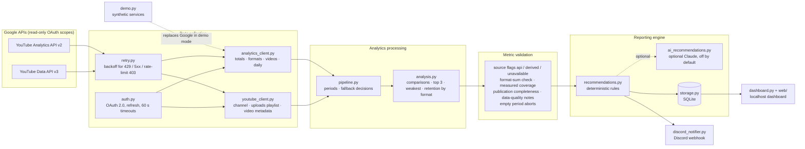

# Architecture

## Overview



One command drives everything: `python -m yt_report run` (Windows, Raspberry Pi cron and
a private CI runner can use the same entry point).

## Modules

| Module | Responsibility |
|---|---|
| `__main__.py` | CLI (`run`, `auth`, `dashboard`, `demo`, `test-discord`, `check`), exit codes, failure notifications |
| `config.py` | `.env` / environment loading and validation (Discord host allow-list, IANA timezone, integer ranges) |
| `auth.py` | OAuth installed-app flow, atomic token save, refresh, `--dry-run` keeps refreshed tokens in memory, HTTP timeouts |
| `retry.py` | Exponential backoff for 429, 5xx and 403 `rateLimitExceeded`; never for `quotaExceeded` |
| `analytics_client.py` | All Analytics API queries; format-filtered per-video rows with verification and measured `Coverage`; derived fallback (`derive_formats`, `derived_avg_view_duration`) |
| `youtube_client.py` | Channel info, uploads-playlist scan (bounded paging), video metadata (title, thumbnail, privacy, live details) |
| `periods.py` | Reporting windows in Pacific time with a data lag |
| `pipeline.py` | Orchestration and fallback decisions; builds the `WeeklyReport` |
| `analysis.py` | Pure calculations: % change, comparisons, top videos, weakest video, retention by format, publication statistics, views by upload age, completeness and data-quality notes |
| `recommendations.py` | Deterministic rule engine incl. the views-trend decision tree |
| `ai_recommendations.py` | Optional Claude API interpretation of verified metrics |
| `formatting.py` | Display formatting and the single rounding rule |
| `storage.py` | SQLite schema (v2), additive idempotent migration, upsert, sent-flag |
| `discord_notifier.py` | Embeds, Discord limits, splitting, retries |
| `dashboard.py`, `web/` | Local HTTP server (stdlib) and the static dashboard |
| `demo.py` | Synthetic services + isolated demo database |

## Data flow of one run

1. **Config** is validated before any network call (webhook host, timezone, numbers).
2. **Auth** loads `token.json` (or `YT_TOKEN_JSON` in CI) and refreshes the access token.
3. **Periods**: "today" is taken in `America/Los_Angeles` (YouTube Analytics dates are Pacific).
   The end date `today − DATA_LAG_DAYS` (default 3) is anchored to the most recent
   `REPORT_WEEK_END` (default Saturday), so the current period is the latest lag-complete
   Sunday–Saturday week and the previous period is the week before. See *Reporting periods*.
4. **API calls** (Analytics ≈ 11–13 requests; Data API ≈ 2 × ⌈uploads / 50⌉ + 2 requests,
   e.g. about 66 for 1,500 uploads — 1 quota unit each, far below the 10,000-unit daily quota):

   | Purpose | API / report | Dimensions | Metrics |
   |---|---|---|---|
   | Channel name, subscribers | Data `channels.list(mine=true)` | — | — |
   | Totals (×2 periods) | Analytics *basic user activity* | none | views, estimatedMinutesWatched, averageViewDuration, averageViewPercentage, subscribersGained, subscribersLost |
   | Shorts / long-form / livestream (×2) | Analytics *playback details* | `creatorContentType` | views, estimatedMinutesWatched, averageViewDuration, averageViewPercentage |
   | Per-video rows, primary (×3 formats ×2 periods) | Analytics *top videos* + filter `creatorContentType==shorts\|videoOnDemand\|liveStream` | `video` | views, engagedViews, estimatedMinutesWatched, averageViewDuration, averageViewPercentage, subscribersGained |
   | Per-video rows, fallback (×2) | Analytics *top videos* (`sort=-views`, `maxResults=200`) | `video` | same |
   | Per-video format (fallback, and new uploads without rows) | Analytics with filter `video==id1,…` (50 IDs/request) | `video,creatorContentType` | views |
   | Uploads playlist | Data `channels.list(part=contentDetails)` → `playlistItems.list` (≤ 40 pages) | — | — |
   | Upload metadata | Data `videos.list(part=snippet,status,liveStreamingDetails)` (50 IDs/request) | — | — |
   | Daily series (14 days) | Analytics *time-based* | `day` | views, estimatedMinutesWatched, subscribersGained, subscribersLost |
5. **Fallback decisions** (`pipeline.py`) — see *Fallback mechanism*.
6. **Validation**: format views must add up to the channel total; per-video coverage is measured;
   every day of the 14-day daily series is checked; empty current period aborts.
7. **Publication statistics and views by upload age** — see below.
8. **Analysis → recommendations → SQLite → Discord → sent-flag.**

## Reporting periods

`periods.compute_periods` (called from `pipeline.build_report` and the demo):

```
end = today_PT − DATA_LAG_DAYS
end = end − ((end.weekday() − REPORT_WEEK_END) mod 7)     # most recent Saturday on or before
current  = [end − 6, end]          previous = current − 7 days
```

| Run (Europe/Bratislava) | Pacific "today" | Selected week |
|---|---|---|
| Tue 10 Nov 2026 10:00 (cron) and 14:00 (retry) | Tue 10 Nov | Nov 1–7 (previous Oct 25–31) |
| GitHub Tue 09:00 UTC | Tue 01:00 PST | Nov 1–7 |
| any run until Mon 16 Nov (Pacific) | Tue–Mon | Nov 1–7 |
| Mon 9 Nov (any hour) | Sun/Mon | Oct 25–31 — Nov 7 is not lag-complete yet |

Why anchoring: v1.2.0 and earlier used a rolling window (`today − lag`), so the period depended on
the exact run time. The Monday 08:00 run (PT Sunday) and the 12:00 "retry" (PT Monday) selected
two different periods, which bypassed the per-period duplicate guard, and in the weeks where EU
and US daylight-saving changes differ (8-hour offset) the weekly step became 8 / 6 days. With the
anchor every run between two Tuesdays (Pacific) selects the same week; hourly simulations over a
full year (incl. Oct/Nov 2026 and Mar 2027) show contiguous Sunday–Saturday weeks without gaps
or overlaps (`tests/test_period_anchor.py`).

The schedule is Tuesday 10:00 Bratislava time: Bratislava is 8–9 hours ahead of Pacific, so this
is always Tuesday 01:00–02:00 in Pacific time, when Saturday is 3 days old.

An explicit `--end-date` is never moved; if it is not the configured week end, a warning is
logged and the period is used as given. `REPORT_WEEK_END=none` restores the rolling window.

## Per-video rows and coverage (v1.2.0)

The top-videos report has **no pagination**: `startIndex` and `maxResults > 200` return HTTP 400
(verified on the live API), so a single query returns at most 200 rows.

**Primary path** — one query with `filters=creatorContentType==<type>` (undocumented for the
top-videos report, works on the live API) for each reported format **and** for every other content
type with views in the format totals (e.g. `posts`). Video formats become per-video rows (the
format comes from the query itself). Other types are counted for coverage only and are never
returned as videos, so a post can never appear in top or weakest videos.

Each type's rows are compared with its API total and the result is **kept** in every case:

| Rows vs. API total | Recorded as | Meaning |
|---|---|---|
| equal | — | complete for that type |
| below, query < 200 rows | `unassigned_views` | the API assigns these views to no video (verified: per-day queries return the same sum) |
| below, query = 200 rows | `truncated_views`, `capped` | confirmed row cap |
| above | `excess_views` | inconsistent API data; coverage is never "complete" |

Per type, at most the API total is counted (`views_rows = Σ min(rows, total)`), so an excess in
one type can never hide a shortfall in another, and a video reported under two formats is one
video row whose views are counted once per format.

If **some** reported-format queries fail, the successful ones are kept and only the failed formats
are filled from the single query (rows whose Analytics format is that format and that are not
already present; `method = by_format+single_query`). If the format lookup is unavailable, those
views are reported as not covered instead of mixing untyped rows.

**Fallback** (single query `sort=-views` + `video==…` format lookup) is used only when the format
totals are unavailable or every reported-format query fails. The unfiltered single query can be
truncated **below** 200 rows (observed: 199 rows while more videos had views), so `capped` means a
confirmed 200-row result, and ≥ 190 rows with missing views sets `truncation_suspected`
(reported as *suspected, not confirmed*). Fewer rows with missing views are reported as
"cause not identified" — an API cap is never claimed just because coverage is incomplete.

**Coverage** is always *measured*: `views_rows / views_reference`, where the reference is the sum
of the API format totals over **all** content types (incl. unspecified and posts), or the channel
total when the format totals are unavailable. `complete` means `views_rows ≥ reference` and no
excess. An incomplete coverage is never displayed as 100 % (capped at 99.9 %). If a capped or
suspected query's smallest row still has ≥ `MIN_VIEWS_WEAKEST` views, a note warns that the
weakest-video check may have missed candidates.

Live checks (figures omitted):

| Week | Single query | Primary path |
|---|---|---|
| busy week (> 200 videos with views) | 200 rows, capped, incomplete | all rows, 100 % — complete |
| week with posts and unassigned views | 199 rows, truncation suspected | 99.9 % — incomplete; a handful of views assigned to no video by the API, posts counted separately |

## Publication statistics (v1.2.0)

| Rule | Implementation |
|---|---|
| Source | Uploads playlist (`contentDetails.relatedPlaylists.uploads`), paged with `nextPageToken`. The playlist is **not sorted by date**, so it is scanned completely. |
| Page limit | 40 pages (2,000 uploads). Reaching the limit with a `nextPageToken` still present → `complete = false` (`page_limit`). A repeated token stops the scan as incomplete. A missing token ends the scan normally. |
| Duplicates | Duplicate video IDs (the live playlist had 23) are counted once. |
| Counted | **Public** uploads only. Private and unlisted uploads dated in the period are counted separately and excluded. |
| Never counted | Scheduled (`liveBroadcastContent = upcoming`) livestreams; uploads without metadata (deleted). A deleted upload marks the stats incomplete only if its playlist-item date is unknown or inside the period. |
| Date | Pacific (`America/Los_Angeles`) date. Livestreams use `liveStreamingDetails.actualStartTime`; premieres classified as `videoOnDemand` use `publishedAt` and count as long-form. Unclassified uploads with an `actualStartTime` use it. |
| Format | Only YouTube Analytics `creatorContentType` (from the per-video rows of both periods, or the `video==…` lookup for new uploads without rows). Never inferred from duration; uploads without a classification are reported as **unclassified**. |

**Views by upload age** compares equivalent periods: *new* = views in a period from public uploads
published in that same period; *older catalog* = views from videos published before the previous
period started, i.e. the same set of videos in both periods. This period's views from last
period's uploads are reported separately. It is `complete` only when both publication stats are
complete and every relevant upload is either in the per-video rows or the rows cover all views.

## Fallback mechanism

| Situation | Result | Source flag |
|---|---|---|
| Format-filtered per-video queries succeed | Primary rows kept; shortfall (unassigned / truncated) or excess recorded; coverage measured | — |
| Some format queries fail | Successful formats kept; failed formats from the single query (typed rows only) | — |
| Every format query fails / format totals unavailable | Per-video rows from the single query + format lookup; reason noted | — |
| Uploads scan fails or channel has no uploads playlist | Publication statistics `unavailable`; decision tree uses the neutral branch | — |
| Format totals query succeeds | API values, unchanged | `api` |
| Format query fails, per-video formats known | Views and watch time summed from per-video rows; AVD weighted by `engagedViews`; avg % viewed **unavailable** | `derived` |
| Format query fails, per-video formats unknown | All format metrics `n/a` | `unavailable` |
| Previous-period format query fails | Per-video rows of the previous period (always fetched since v1.2.0), then the same rules apply | `derived` / `unavailable` |
| Per-video format lookup fails | Top videos still shown; weakest video skipped | — |
| Current period returns no data at all | Run stops with exit code 6; nothing stored or sent | — |
| Previous period returns no data | Comparisons `n/a`, note added | — |

**Notes are built from the final state only** (`analysis.data_quality_notes`). The API client
never writes warnings; a query that failed but was recovered by the fallback cannot leave a
stale "unavailable" message. When the two periods were measured with different methods
(API vs derived), format trends are not shown.

## Metric definitions

Verified on 2026-11-07 against the live API for a real channel (figures below are relative or
illustrative, not the channel's data) and the
[official metric definitions](https://developers.google.com/youtube/analytics/metrics).

| Metric | Unit | Meaning | Additive across formats/days? |
|---|---|---|---|
| `views` | count | Views as counted by YouTube; the definition differs between report types. | Yes |
| `engagedViews` | count | Views past the first frame, or when the user clicks/taps to play. | Yes |
| `estimatedMinutesWatched` | minutes (integer) | Total watch time. Shown as hours (`/ 60`). | Yes (±1 min rounding per row) |
| `averageViewDuration` (AVD) | seconds (integer) | Average length of a **playback**. Excludes looping clips (since 2021-12-13). | No — weighted average |
| `averageViewPercentage` | percent (not a fraction) | Average percentage of a video watched during a playback. Excludes looping clips. | No |

**`views` vs `engagedViews`.** `views` also counts starts that never really played;
`engagedViews` counts only engaged playbacks. On the validation channel `views` was about 2.4×
higher, so the two must never be swapped.

**AVD is a per-playback average weighted by `engagedViews`.**

- `watch time / views` is **not** the AVD: on the validation week it gave less than half of the
  AVD returned by the API.
- Per-format AVDs weighted by `engagedViews` reproduce the channel AVD to the second; per-day AVDs
  give the same result. Weighted by `views` they overstate it by about 10 %.
- The derived fallback therefore computes AVD as the `engagedViews`-weighted mean of per-video
  AVDs. Validated on live data: derived AVDs matched the API within one second per format.
  If any video lacks `engagedViews` or AVD, or the group has zero engaged views, the result is `unavailable`.

**How to read average % viewed.** The channel-wide value behaves as
*total watched time ÷ total length of the content played*, not as an average of per-format
percentages. Example (illustrative): Shorts ~60 %, long-form ~30 % and livestream ~5 % can give
a channel value below 20 %, while a view-weighted average would suggest above 40 %. Long
livestreams dominate the denominator. Without per-playback video lengths this cannot be rebuilt, so the
derived fallback reports it as `unavailable`.

**Format mix moves channel-wide averages.** A change in the share of Shorts vs long-form can move
the channel AVD and avg % viewed sharply even when no format changed (observed: the channel AVD
more than tripled between two weeks only because the Shorts share of views fell, while the
long-form AVD stayed within a few seconds). Both KPIs
carry the note *"Channel-wide averages depend on the format mix — compare per-format values."*

**Derived watch time.** The API rounds `estimatedMinutesWatched` to whole minutes **per row**.
Summing ~200 per-video rows (many short Shorts) can understate the total (live check: about
−4 %). No correction is applied; the report states
*"Derived watch time may be slightly understated because of per-video minute rounding."*

## Retention logic (recommendations)

The channel-wide avg % viewed is never used to judge retention. `analysis.retention_changes`
compares each format with **itself** in the previous period:

| Condition | Value |
|---|---|
| Both periods API-sourced and avg % viewed available | required |
| Views per format in **both** periods | ≥ 100 |
| Significant change | ≥ 5 pp (Shorts), ≥ 3 pp (long-form), ≥ 1 pp (livestream) **and** ≥ 10 % relative |

Status is `improved`, `declined`, `stable` or `insufficient`. Declines and improvements create
recommendations; if fewer than two rules fire, a "stable within each format" summary is used.

## Views-trend decision tree (v1.2.0)

Applies when channel views change by ≥ 15 % (and ≥ 100 views). It is symmetric: for a decline
"fewer/down", for growth "more/up". The first matching branch wins (`recommendations.views_trend_branch`).

| # | Branch | Condition | Wording |
|---|---|---|---|
| 0 | `unavailable` | Publication stats missing or incomplete | Neutral: the change "cannot be separated" with the available data |
| 1 | `upload_spike` | The dominant period's own new uploads made ≥ 50 % of its views (previous period for a decline, current for growth) **and** older-catalog views moved < ±15 % | Views moved with the new uploads (cooling off / arriving); no title or thumbnail advice |
| 2 | `publishing` | Fewer (decline) / more (growth) public uploads in at least one format (decline needs ≥ 1 upload last period) | "… coincided with" + per-format counts + new vs older-catalog views |
| 3 | `performance` | Upload count not lower (decline) / not higher (growth) **and** both new-upload and older-catalog views moved with the total | Decline: check CTR, refresh titles/thumbnails of underperforming uploads + retention by format. Growth: follow up on the most-viewed video |
| 4 | `unseparated` | Data complete, no branch matched | Neutral description of both segments |

Constants: `SIGNIFICANT_CHANGE = 15`, `NEW_UPLOAD_DOMINANCE = 50`, `CATALOG_STABLE = 15`.
Relationships are always phrased as **"coincided with"**; no rule claims a cause, and titles or
thumbnails are only mentioned in branch 3 (never merely because total views declined).

On the first production week (views down sharply), v1.1 recommended refreshing titles/thumbnails.
The data showed that most of the previous week's views came from that week's own new uploads, fewer
uploads followed and the older catalog fell as well, so branch 1 does not apply and branch 2
reports the publishing change with both segments.
Other thresholds: ±15 % views = significant; long-form retention < 35 % low / ≥ 50 % strong;
Shorts < 70 % low; < 1 net subscriber per 1,000 views = weak conversion; one video ≥ 50 % of views
= dependency; no trend rules below 100 weekly views.

## Rounding rules

All display rounding uses **round half away from zero on the decimal representation**
(`formatting.round_half_up`, mirrored by `rh()` in `web/static/app.js`; parity checked on 13 edge
cases). Stored and compared values are never rounded.

| Value | Display |
|---|---|
| Counts (views, subscribers) | integer, thousands separator |
| Watch time | hours; 1 decimal ≥ 10 h, otherwise 2 decimals (1,227 min → 20.5 h) |
| AVD | `m:ss` / `h:mm:ss`, nearest second |
| Percentages, % change | 1 decimal; −0.0 is shown as 0.0 |
| Retention change | percentage points (pp), 1 decimal |

## Run lock

`run` (except `--dry-run`) takes an exclusive, non-blocking OS lock on `data/yt_report.lock`
(next to `DATABASE_PATH`) before credentials, API calls, the database or Discord are touched, and
holds it until the sent-flag is stored. Standard library only: `fcntl.flock` on Linux / the Pi,
`msvcrt.locking` on Windows. The operating system releases the lock when the handle closes — after
success, an exception, `Ctrl+C`, a kill or a crash (on Windows asynchronously, normally within
moments) — so a stale lock cannot block later runs; the lock file is never deleted. A second run
exits with code 8 and does nothing. `--dry-run` is not locked (it writes nothing). Together with the
per-period sent-flag and the anchored week, a retry or a concurrent manual start can no longer send
a report twice. The Pi wrapper's `flock` stays as an outer guard. Different machines with separate
databases are not coordinated.

## Overlapping periods

Report #1 (Oct 29 – Nov 4, 2026) predates the Sunday–Saturday anchoring, so the first anchored
report (Nov 1 – 7, previous Oct 25 – 31) overlaps it. `analysis.period_overlaps` compares the
current and previous periods with the stored report periods of the same channel (`Storage.periods`;
`--dry-run` reads them via a read-only, immutable connection that creates no files). A stored report
counts as overlapping if it intersects the current period, or the previous period while no stored
report covers exactly that previous period. Such a report gets:

* a first data note: *"This report's periods overlap earlier stored report(s) for … Week-over-week
  figures compare … with … using YouTube Analytics data, not with those earlier reports."*;
* a Discord overview line *"⚠ Reporting week realigned …"*;
* a "⚠ overlaps …" marker in the dashboard history and trend header.

Comparisons themselves are unchanged (always the API's previous 7 days). From the second anchored
week on, the previous period is a stored report, so nothing is flagged. Report #1 is never modified.
If the previous period has no data, the overview says *"No valid previous comparison"*.

## Partial periods

YouTube Analytics returns no daily rows for days it has not processed yet (live: on Sunday
2026-11-08 the days Nov 6–7 had no data at all). `pipeline.build_report` fetches the daily series
right after the channel totals and checks the **last day of the current period with data**
(`last_day_with_data`):

| Situation | Behaviour |
|---|---|
| Data through the last day | normal report |
| Trailing days without data, no flag | `IncompletePeriodError` → exit 9, nothing stored or sent, before any per-video query |
| Trailing days without data, `--allow-incomplete` | partial report: `data_through`, first data note *PARTIAL REPORT …*, Discord title *PARTIAL Weekly Report (5/7 days)*, exact data range, KPI and format values **without** trends, arrows, previous values or % changes, recommendations replaced by "Recommendations paused — partial week" (no rules, no Claude) |
| No day with data | refused even with the flag |

Metric sources and aggregation are unchanged (the API returns the available days for the requested
range). A partial report is never stored, so it cannot occupy the week's snapshot or sent-flag; it
is posted only with `--send-partial` (ignored with `--dry-run` / `--no-discord`). An explicit
`--end-date` within the processing lag therefore can no longer produce an unlabelled partial week.
Days missing in the middle of a period (no activity) do not trigger this; they are listed in the
data notes as before.

## Discord data notes

Discord limits a field to 1,024 characters. `discord_notifier.fit_notes` adds whole notes in order
and, if not all fit, ends with *"… +N more notes on the dashboard"*; a note is never cut in the
middle. The overlap note is placed first. All notes stay complete in the database and the dashboard.

## Other design decisions

| Decision | Reason |
|---|---|
| `creatorContentType`, not duration | Shorts can be up to 3 minutes; duration is not a reliable classifier. |
| camelCase normalisation | The live API returns `shorts`, `videoOnDemand`, `liveStream`, … Unknown values are kept, never re-labelled. |
| Livestream is its own format | Never merged into long-form; format views must add up to the channel total. |
| Per-video format via filtered query | `video,creatorContentType` without a filter returns HTTP 400 (verified); with `video==…` it works. Ambiguous videos stay unclassified. |
| Weakest video = ratio to own-format median | Shorts retention often exceeds 100 % (loops); cross-format comparison would always flag long-form. Requires ≥ 3 videos with ≥ 30 views per format. |
| Data lag of 3 days | The last 1–2 days are usually incomplete; a note lists every day of the 14-day series without rows. |
| Weeks anchored to Saturday | Calendar weeks; every run and retry in a week selects the same period, independent of run time and DST offsets. |
| Empty response = unavailable | No row from the API is not a measured zero; an empty current period stops the run. |
| Upsert per (channel, period) + `discord_sent_at` | Re-runs never duplicate rows or Discord posts. |
| OS file lock per run (`locking.py`) | Two simultaneous runs could both see "not sent yet" and post twice; the lock serialises them. |
| SQLite WAL | Dashboard can read while a report is written; robust on SD cards. |
| stdlib HTTP server | One JSON endpoint does not justify a web framework. |
| Demo mode replaces only the transport | Synthetic services answer the same API calls, so the demo exercises the real pipeline. |

## Database schema

```
reports(id, channel_id, channel_title, subscriber_count, period_start, period_end,
        prev_start, prev_end, generated_at, notes, weakest_note, discord_sent_at)
        UNIQUE(channel_id, period_start, period_end)
totals(report_id, which[current|previous], views, minutes_watched,
       avg_view_duration_s, avg_view_pct, subs_gained, subs_lost)
format_stats(report_id, which, content_type, views, minutes_watched,
             avg_view_duration_s, avg_view_pct, source[api|derived|unavailable], complete)
video_stats(report_id, video_id, rank, title, thumbnail_url, url, content_type, views,
            minutes_watched, avg_view_duration_s, avg_view_pct, subs_gained,
            is_top, is_weakest, format_median_pct)
recommendations(report_id, position, source[rules|claude], title, body)
daily_stats(channel_id, day, views, minutes_watched, subs_gained, subs_lost, updated_at)
publication_stats(report_id, which, status, complete, shorts, long_form, livestream, other_types,
                  unclassified, private_excluded, unlisted_excluded, upcoming_excluded,
                  incomplete_reason)                                         -- v2
coverage(report_id, which, method[by_format|single_query], rows, views_rows, views_reference,
         capped, capped_min_views, complete, fallback_reason)                -- v2
views_by_age(report_id, total_cur, total_prev, new_cur, prev_uploads_cur, new_prev,
             older_cur, older_prev, complete)                                -- v2
meta(key, value)   -- schema_version
```

Production: `data/yt_report.db`. Demo: `data/demo/demo.db` (refuses to run if both paths are equal).

**Schema migration v1 → v2** runs automatically when `Storage` opens a database (any command that
reads or writes it, incl. the dashboard). It is additive and idempotent, in one transaction:
`CREATE TABLE IF NOT EXISTS` for the three new tables, then `meta.schema_version` is raised to 2.
No existing table or row is altered or deleted. Reports stored by v1.x have no rows in the new
tables and are returned with `publications`, `coverage` and `views_by_age` = `null`
(dashboard: "n/a"). A database with a newer schema version than the program is refused.
Verified on a copy of the production database: all v1 rows byte-identical after migration.
Re-running a stored period (`--end-date`) rewrites that period's children (including
recommendations) — intentional, as before.

## Error handling and exit codes

| Failure | Behaviour | Exit |
|---|---|---|
| Invalid configuration (webhook host, timezone, numbers) | Stops before any API call | 2 |
| Token missing / expired / revoked | Discord alert with the fix command | 3 |
| API 429 / 5xx / 403 rate limit | Exponential backoff, 4 attempts; then alert | 4 |
| API 403 quota / API disabled | No retry; alert names the likely cause | 4 |
| Stalled connection | 60 s socket timeout, retried like a network error; then alert | 1 |
| Unsupported dimension | Fallback, labelled in the report | 0 |
| No data for the current period | Nothing stored or sent; alert | 6 |
| SQLite error | Nothing sent (the duplicate guard needs the DB); alert | 7 |
| Another run holds the lock | Nothing done (no API call, DB write or Discord post); logged only | 8 |
| Last day(s) of the period without data (no `--allow-incomplete`) | Nothing stored or sent; alert | 9 |
| Discord 429 | Waits `retry_after` (also if the body is not JSON) | — |
| Discord down | Snapshot stored, not marked sent; the next run sends it | 5 |
| Claude error / refusal / malformed JSON | Falls back to rule-based recommendations | 0 |
| Unexpected exception | Logged with traceback (redacted); short alert | 1 |

Discord alerts contain the error type and a short, redacted message only.
