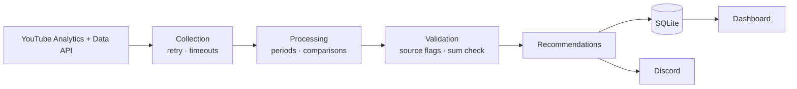

# Case study — automating weekly YouTube analytics reporting

*Independent portfolio project by Davixeqq, built with AI-assisted development (Claude Code)
and validated against the author's own YouTube channel. Figures here are relative or synthetic; no
private channel data is published. It has not been deployed at any company.*

## Problem

A creator publishing Shorts, long videos and livestreams wants one answer every Monday:
*how did last week go compared with the week before, and what should I do next?*
YouTube Studio has the raw numbers, but getting a comparable weekly view is a manual routine.

## Why manual reporting is inefficient

- **Repetitive**: the same date ranges, filters and notes have to be set up every week.
- **Inconsistent**: slightly different windows or definitions make weeks incomparable.
- **No history in one place**: last week's figures have to be remembered or copied somewhere.
- **Easy to misread**: channel-wide averages move when the format mix changes. In one validated
  week, the channel's average view duration more than tripled — not because viewers watched
  longer, but because the Shorts share of views fell sharply. Long-form duration stayed within a
  few seconds of the week before.

## Technical solution

A Python CLI (`python -m yt_report run`) that runs on a schedule and:

1. authenticates with OAuth 2.0 (read-only scopes) and calls the YouTube Analytics and Data APIs,
2. builds two comparable 7-day windows in YouTube's reporting timezone,
3. splits results into Shorts, long-form and livestream using YouTube's own classification,
4. validates and labels every figure (`api`, `derived`, `unavailable`),
5. produces deterministic recommendations,
6. stores a snapshot in SQLite, posts a Discord report once per period, and feeds a dashboard.

## Architecture

Details: [ARCHITECTURE.md](ARCHITECTURE.md).

## Implementation

- **Python 3.11+**, modular package (19 modules), no web framework — the dashboard uses the
  standard-library HTTP server and vanilla JavaScript.
- **Pure analysis functions** (comparisons, top/weakest videos, retention by format) separated
  from API access, so they are unit-testable without network.
- **Deterministic rule engine**; an optional Claude API mode receives only verified metrics and
  falls back to the rules on any error. It is disabled by default.
- **Three deployment targets** with one command: Windows, Raspberry Pi cron (lock file, backups),
  GitHub Actions CI for the test suite.
- **Demo mode** replaces only the API transport with synthetic services, so the whole pipeline can
  be shown without credentials or real data.

## Challenges

| Challenge | How it was found | Resolution |
|---|---|---|
| Shorts and long-form showed 0 views | First real dry-run | The API returns camelCase values (`shorts`, `videoOnDemand`, `liveStream`); added normalisation and kept livestreams separate. |
| HTTP 400 on the top-videos query | Live API probing | `video,creatorContentType` is rejected without a video filter. Top videos use `dimensions=video`; formats come from a filtered follow-up query. |
| AVD did not equal watch time ÷ views (less than half) | Read-only metric audit | AVD is a per-playback average weighted by `engagedViews`; the fallback was corrected and validated. |
| Channel average % viewed far below Shorts and long-form | Same audit | It is watched time ÷ length played; long livestreams dominate. Documented; the fallback marks it unavailable. |
| A recovered fallback still printed "unavailable" | Final audit | Notes are now built from the final report state only. |
| Retention advice reacted to format-mix changes | Final audit | Retention is compared per format against itself, with sample-size and threshold checks. |

## Metric accuracy

- API values are authoritative and never recalculated.
- Format views and watch time add up exactly to the channel totals on the validated week
  (Shorts + long-form + livestream = channel total, for both views and watch time).
- Missing data is `n/a`, never zero; empty API responses stop the run instead of producing a zero report.
- One rounding rule in Python and JavaScript (checked on 13 edge cases).

## Fallback handling

If the per-format API query fails, totals are derived from per-video rows and clearly labelled.
Forcing that path on live data gave:

| Format | Views (derived vs API) | AVD (derived vs API) | Watch time (derived vs API) |
|---|---|---|---|
| Shorts | identical | < 1 s difference | about −12 % |
| Long-form | identical | < 1 s difference | about −3 % |
| Livestream | identical | < 1 s difference | < 1 % |

The watch-time gap comes from YouTube rounding minutes per video; it is disclosed in the report
rather than corrected artificially. Average % viewed is not derived because it cannot be rebuilt
reliably.

## Testing and validation

- 337 automated tests (pytest, ~15 s, no network) covering calculations, edge cases, fallbacks,
  notification lifecycle, retention logic, rounding, Discord limits, security validation, CLI exit
  codes, duplicate-send prevention and demo isolation.
- Fake API services reproduce behaviour observed on the live API (camelCase values, HTTP 400
  without a filter).
- Read-only validation runs against the real API with the token kept in memory and file hashes
  of credentials checked before and after.

## Results

Verified outcomes only:

- A working weekly report generated from the real channel's data (dry-run), with all format totals
  consistent with channel totals.
- Three API behaviours discovered and handled that are not obvious from the documentation.
- A metric methodology that separates real retention changes from format-mix effects.
- A demo mode and documentation that let a reviewer run the project without credentials.

Production runs and Discord delivery are operated privately by the owner and are not part of
this repository; the Raspberry Pi deployment files are not covered by automated tests. No time or
cost savings have been measured.

## Potential business applications

The pipeline shape — *API extraction → validation → comparison → rule-based interpretation →
chat notification + dashboard + history* — fits many recurring internal reports, for example:

- weekly sales or e-shop KPIs from an e-commerce or ERP API,
- marketing campaign summaries from ad-platform APIs,
- support-ticket volume and response-time trends from a helpdesk API,
- operational alerts delivered to Slack / Teams / Discord instead of manual checks.

The reusable parts are the source labelling, the "missing is not zero" rule, idempotent
snapshots with a sent-flag, and a demo mode that keeps production data private.
